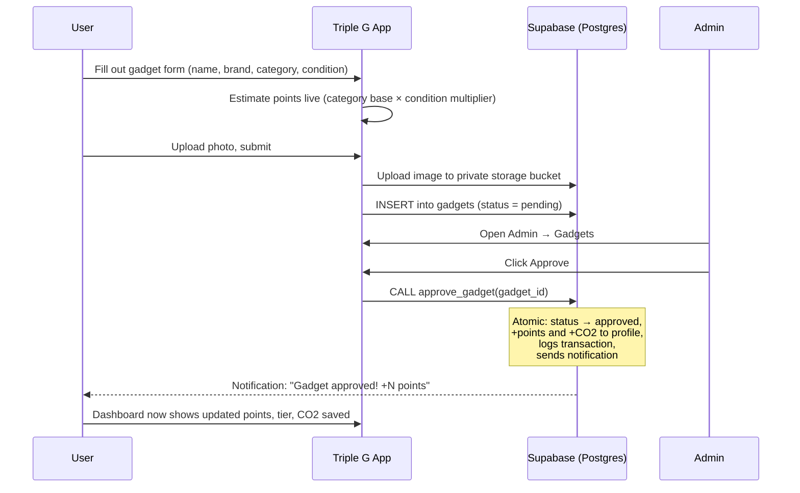
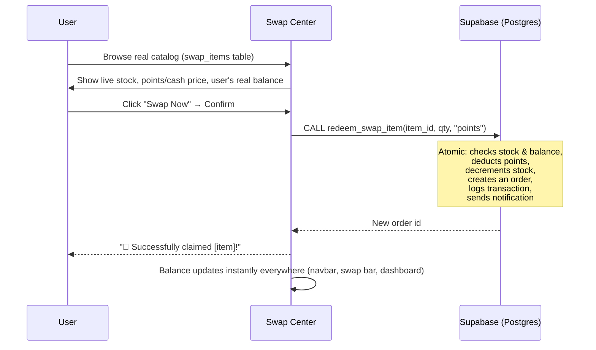
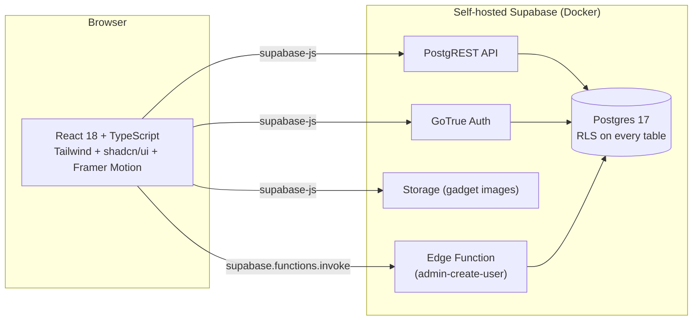

# Triple G — Green Gadget Grid
### Presentation Guide

> A circular-economy web platform where people recycle old electronics for real reward points, redeem those points for refurbished gadgets, and track the environmental impact of every device they keep out of a landfill.

---

## 1. The Problem

- E-waste is the fastest-growing waste stream in the world. Most of it ends up in landfills instead of being recycled, even though it contains recoverable materials (and hazardous ones that shouldn't be there).
- People have no simple, rewarding way to responsibly dispose of an old phone, laptop, or pair of headphones — so it sits in a drawer, or goes in the trash.
- There's no visibility into the *impact* of recycling — no one can see the CO₂, water, or energy they've actually saved.

## 2. The Solution

**Triple G** turns recycling into a transaction with a visible payoff:

1. A user **submits a gadget** they no longer need.
2. An admin **reviews and approves** it.
3. The user is **credited points and CO₂ impact** automatically.
4. Points can be **spent in the Swap Center** on refurbished devices, or redeemed in the **Rewards Center** for gift cards, donations, and perks.
5. Every step is tracked — points balance, tier progress, transaction history, and a personal environmental impact dashboard.

It's Lovable's original prompt-built demo, migrated off Lovable Cloud onto a fully self-hosted stack (pnpm + local Supabase/Postgres) and rebuilt so every screen reads and writes real data instead of hardcoded mock arrays.

---

## 3. Who Uses It

| Role | What they do |
|---|---|
| **User** | Submit gadgets, track listings, swap points for refurbished devices, redeem rewards, monitor points/tier/CO₂ impact, read e-waste education content |
| **Admin** | Review and approve/reject gadget submissions, manage users and roles, manage the swap catalog and rewards, publish articles/announcements, handle support tickets and feedback, oversee orders/payouts/transactions |

---

## 4. Core User Journey — Submit a Gadget

Rejections follow the same reviewed path but simply flip the gadget to `rejected` and notify the user — no credit is issued.

---

## 5. Core User Journey — Swap a Device for Points

The same atomic-RPC pattern powers the **Rewards Center** (`redeem_reward`) — gift cards, tree-planting donations, merch — each redemption is a single database transaction, so a user can never spend points they don't have, or claim stock that's gone.

---

## 6. What Makes It "Real" (not a mockup)

Every number on screen is live, derived data — not a hardcoded string:

- **Points balance** — `profiles.points`, updated by whichever action changed it, reflected in the navbar in real time
- **Tier** (Bronze → Silver → Gold → Platinum) — a database trigger recalculates it automatically every time points change
- **CO₂ saved / e-waste diverted** — accumulated from actually-approved gadgets, not a static figure
- **Points trend chart, recent activity, achievements** — computed from the user's real transaction and gadget history
- **Admin stat cards** (Total Gadgets, Pending Review, etc.) — computed from live table counts, not sample data

---

## 7. Feature Tour

### User Dashboard
- **Home** — KPI cards, 6-month points trend chart, tier progress, recent activity, quick actions
- **My Listings** — every gadget submitted, with live status (pending/approved/rejected/sold)
- **Swap Center** — full catalog with search, category/condition filters, wishlist, compare, quick-view, points/cash toggle
- **My Orders** — redemption history with tracking and status
- **Rewards Center** — points-cost catalog, tier badges, live "afford it?" gating
- **Transactions** — full ledger (earnings, redemptions, purchases) with CSV export
- **Impact Tracker** — CO₂/water/energy saved, monthly chart, achievement badges
- **Notifications** — real inbox (gadget approved/rejected, order placed, reward redeemed), mark read/delete
- **Profile** — edit real account details

### Admin Panel
- **Gadgets** — review queue, one atomic approve/reject action (credits the submitter automatically)
- **Users** — promote/demote admins, delete accounts, create new users (via a secure server-side Edge Function so it never hijacks the admin's own session)
- **Articles / Announcements** — full content CRUD, shared live with the public Awareness page
- **Swaps (catalog), Orders, Payouts, Tickets, Feedback, Transactions** — live management screens with status workflows and delete/edit actions

### Public Pages
- Landing page, Awareness/education hub, About, Recycling pickup map, Login/Register

---

## 8. Architecture

- **Frontend**: React 18, Vite 5, TypeScript, Tailwind CSS, shadcn/ui, Framer Motion, Recharts, React Router
- **Backend**: Self-hosted Supabase — Postgres 17, GoTrue (auth), PostgREST (data API), Storage, one Edge Function
- **Package manager**: pnpm (pinned, npm/yarn/bun blocked)
- **Local dev**: Docker via the Supabase CLI — `pnpm supabase:start`, `pnpm db:reset`

---

## 9. Data Model (key tables)

| Table | Purpose |
|---|---|
| `profiles` | Points, tier, CO₂ saved — one row per user |
| `user_roles` | admin/user role assignment (never stored on profiles) |
| `gadgets` | Submitted devices and their review status |
| `swap_items` | The refurbished-device catalog |
| `orders` | Swap Center redemptions (points or cash) |
| `rewards` / `redemptions` | Rewards Center catalog and claims |
| `transactions` | Full points/cash ledger |
| `notifications` | In-app inbox |
| `articles` / `announcements` | Content management |
| `tickets` / `feedback` | Support |
| `payouts` | Cash-out requests |

## 10. Security Model

- **Row Level Security (RLS) on every table** — a user can only see/edit their own rows; admins get explicit override policies
- **Roles live in `user_roles`**, checked via a `SECURITY DEFINER` function (`has_role`) — never trusted from client input
- **Privileged actions are RPCs, not raw table writes** — approving a gadget, changing someone's role, deleting an account, or redeeming points all run as atomic, permission-checked Postgres functions, so there's no window for a half-applied state or a bypassed check
- **Admin user creation** goes through a server-side Edge Function holding the service-role key — the key never reaches the browser
- **Session integrity** — the app verifies a cached login against the server on load and signs out stale sessions rather than trusting a locally-decoded token

---

## 11. Demo Script (suggested walkthrough)

1. **Land on the homepage** — show the value proposition and impact counters.
2. **Register a new account** → land on the dashboard, points at 0.
3. **Submit a gadget** — fill the form, watch the point estimate update live, submit.
4. **Switch to the admin account** → Admin → Gadgets → approve it.
5. **Back on the user account** → refresh dashboard: points and CO₂ jumped, a notification appeared, tier may have changed.
6. **Go to the Swap Center** → redeem points for a refurbished item → balance updates instantly across the whole app.
7. **Show Studio (`localhost:54323`)** briefly to prove it's a real database, not mock JSON.

---

## 12. Demo Credentials

| Role | Email | Password |
|---|---|---|
| Admin | `admin@tripleG.com` | `admin123` |
| User | `user@tripleG.com` | `user123` |

---

## 13. What's Next

- Trade-in flow: let a user offer one of their own approved gadgets toward a swap item (the `swaps` table already models this; no UI creates these rows yet)
- Real payment processing for cash-based orders/payouts
- Push/email delivery for the notification preferences already in the UI
- Code-splitting the production bundle (currently one ~1.6MB chunk)
